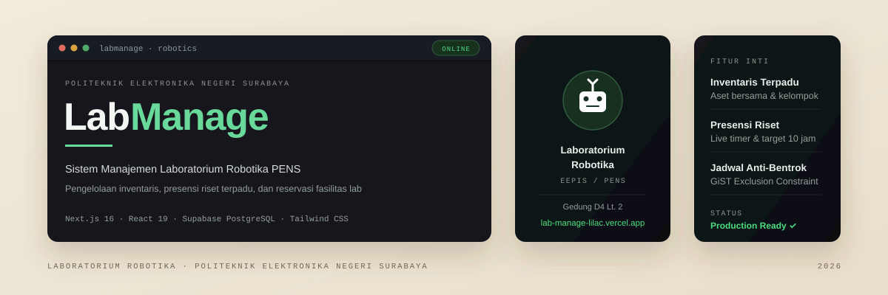
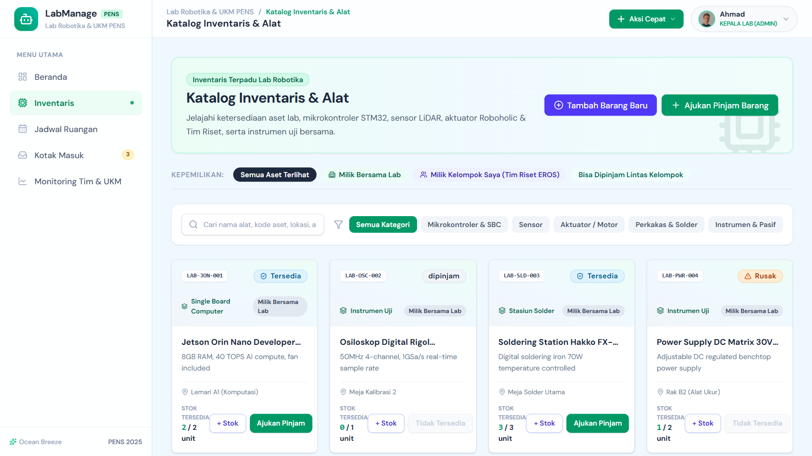
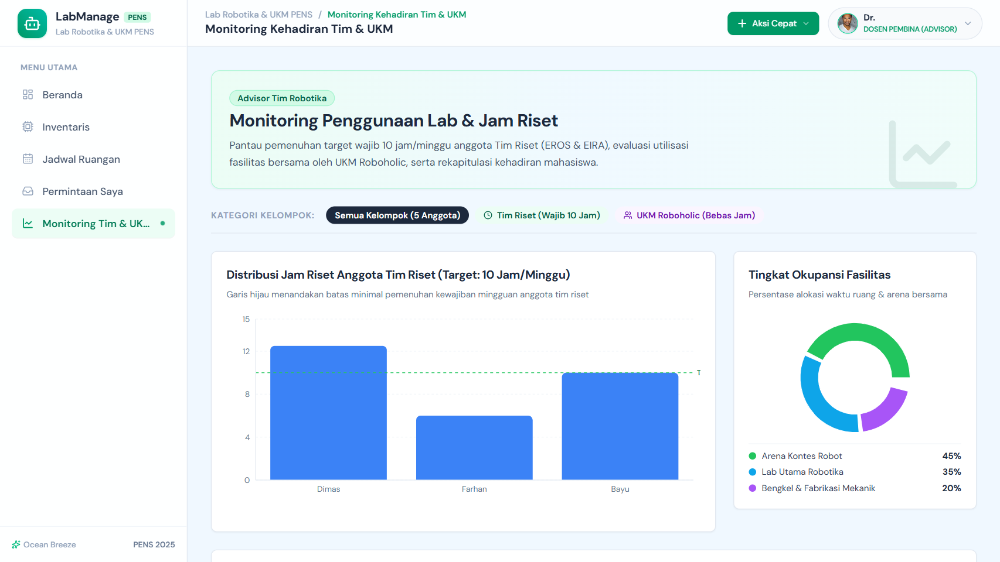
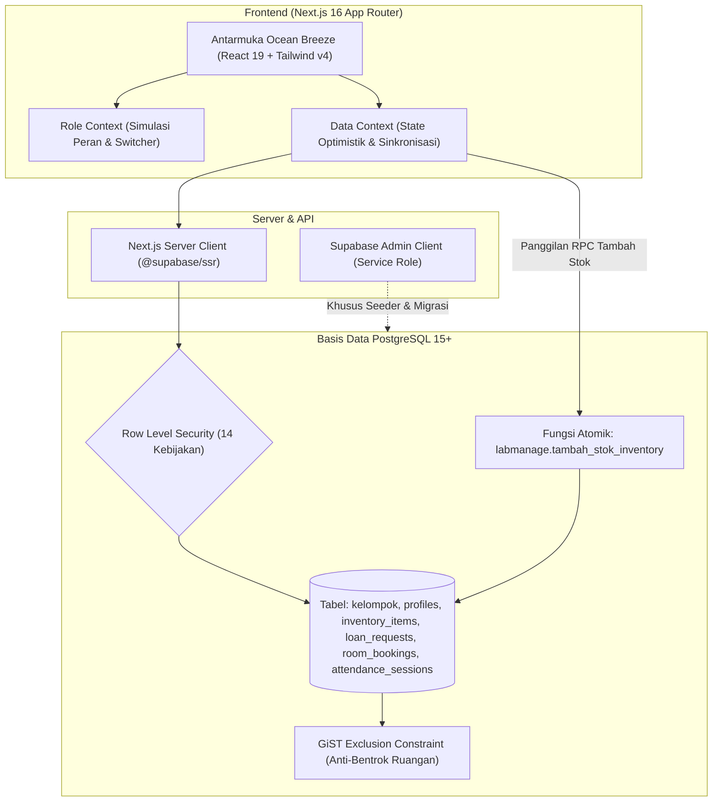

<p align="center">
  
</p>

<p align="center">
  <strong>Sistem terpadu pengelolaan fasilitas, inventaris, dan presensi riset Laboratorium Robotika PENS.</strong><br />
  Pemisahan aset bersama dan kelompok, pemantauan jam riset mingguan, serta pencegahan bentrok fasilitas arena uji coba.
</p>

<p align="center">
  
  
  
  
  
  
</p>

<p align="center">
  <a href="https://lab-manage-lilac.vercel.app">Coba Aplikasi Live</a> ·
  <a href="#menjalankan-secara-lokal">Jalankan Lokal</a> ·
  <a href="#arsitektur-sistem">Arsitektur</a> ·
  <a href="docs/PRD.md">Spesifikasi Produk (PRD)</a> ·
  <a href="docs/USAGE.md">Panduan Penggunaan</a>
</p>

---

## Masalah yang Diselesaikan

Laboratorium Robotika Politeknik Elektronika Negeri Surabaya (PENS) menaungi dua kategori kegiatan mahasiswa dengan tata kelola yang berbeda:

1. **Tim Riset Robotika Nasional** yang dibebani target wajib presensi 10 jam riset per minggu untuk persiapan kompetisi robot nasional.
2. **Unit Kegiatan Mahasiswa (UKM) Robotika** (seperti Roboholic) yang menjadi wadah eksplorasi minat bakat mahasiswa dan tidak dibebani target jam riset mingguan.

Ketika kedua kelompok ini beraktivitas di satu gedung laboratorium bersama, timbul tiga kendala operasional harian:

- **Bentrok Jadwal Arena Uji Coba**: Dua tim robot memesan arena lapangan kontes atau mesin perakitan mekanik pada rentang waktu yang sama tanpa koordinasi terpusat.
- **Kekacauan Aset & Komponen**: Aset milik bersama lab sering tertukar dengan modul khusus yang dibeli dari anggaran riset tim tertentu.
- **Ketidakjelasan Jam Riset**: Presensi tim riset masih dicatat secara terpisah sehingga pembina dan kepala lab kesulitan mengevaluasi kedisiplinan persiapan kontes.

LabManage menyatukan pencatatan inventaris, reservasi arena, dan pelacakan jam riset dalam satu platform web yang membedakan hak akses data berdasarkan peran dan kelompok pengguna.

---

## Tinjauan Produk

<p align="center">
  
</p>

<p align="center"><em>Tangkapan layar aplikasi produksi pada sesi Anggota Tim Riset (Dimas Aditya) dengan data benih dummy.</em></p>

### Matriks Peran dan Izin Akses

| Peran | Ruang Lingkup & Kemampuan Utama |
|---|---|
| **Admin Lab (Kepala Lab)** | Menambah barang baru ke inventaris, menambah kuantitas unit stok secara atomik, memverifikasi laporan kerusakan/kehabisan alat, serta memantau seluruh utilisasi lab. |
| **Anggota Tim Riset** | Menjalankan live-timer presensi lab, memantau capaian target 10 jam mingguan, meminjam instrumen lab, dan mereservasi slot arena uji coba. |
| **Anggota UKM (Roboholic)** | Kartu presensi otomatis beralih ke status bebas jam riset, dapat meminjam alat lab yang dialokasikan terbuka, dan mereservasi fasilitas perakitan. |
| **Advisor (Dosen Pembina)** | Memantau grafik kepatuhan jam riset mahasiswa bimbingan, memonitor tingkat okupansi ruangan lab, dan melihat permohonan pinjam alat. |

---

## Alur Kerja Utama

### 1. Manajemen Inventaris & Penambahan Unit Stok (Admin)

<p align="center">
  
</p>

- Admin dapat menambahkan barang baru lengkap dengan penentuan kepemilikan: **Milik Bersama Lab** atau **Milik Kelompok Tertentu** (seperti Roboholic), serta opsi izin pinjam lintas kelompok.
- Admin dapat menambah kuantitas unit barang yang sudah ada melalui tombol **+ Stok**. Pembaruan dilakukan secara atomik di database PostgreSQL (`SELECT ... FOR UPDATE`), sehingga status barang yang sebelumnya **Habis** otomatis berganti ke **Tersedia**, sementara status **Rusak** tetap dipertahankan.

### 2. Monitoring Utilisasi Fasilitas & Jam Riset (Advisor & Admin)

<p align="center">
  
</p>

- Menampilkan grafik batang capaian jam mingguan setiap anggota tim riset terhadap garis batas target 10 jam.
- Menampilkan persentase alokasi waktu ruangan lab (Arena Kontes Robot, Lab Utama, dan Bengkel Mekanik).
- Halaman ini dilindungi aturan hak akses: anggota biasa yang mencoba membuka rute `/monitoring` akan langsung diblokir dengan tampilan peringatan batas akses.

---

## Arsitektur Sistem



- **Frontend**: Dibangun dengan Next.js 16 App Router dan React 19, menggunakan tema visual *Ocean Breeze* (Alice Blue `#f0f8ff` dan Emerald Green `#047857`) sesuai `DESIGN.md`.
- **Keamanan Data**: Setiap tabel di schema `public` dilindungi Row Level Security (RLS). Seluruh fungsi pembantu otentikasi disimpan di schema terisolasi `labmanage` untuk mencegah paparan API publik.
- **Pencegahan Bentrok Jadwal**: Tabel `room_bookings` mengimplementasikan ekstensi `btree_gist` dan *PostgreSQL Exclusion Constraint* (`tstzrange(waktu_mulai, waktu_selesai) WITH && WHERE status = 'aktif'`) sehingga penumpukan jadwal ruangan yang sama pada jam yang sama ditolak langsung di level database.

---

## Tech Stack

| Lapisan | Komponen / Pustaka | Versi | Peran dalam Sistem |
|---|---|---|---|
| **Framework** | Next.js | `16.4.3` | App Router, Server Components, Turbopack builder |
| **UI Library** | React & React DOM | `19.3.0` | Komponen interaktif modern |
| **Styling** | Tailwind CSS | `v4.x` | Desain antarmuka utilitas responsif |
| **Ikonografi** | Lucide React | `1.62.0` | Ikon visual sistematis dan konsisten |
| **Komponen Primitif** | Radix UI | `1.x` | Dialog modal, Sheet slide-over, Avatar, Progress bar |
| **Visualisasi Data** | Recharts | `3.10.1` | Grafik batang jam riset dan diagram donat okupansi |
| **Database & Auth** | Supabase PostgreSQL | `15+` | Relational database, Auth engine, dan Row Level Security |
| **Supabase Client** | `@supabase/ssr` & `supabase-js` | `0.12.7` / `2.118.0` | Klien browser dan server terisolasi |
| **Deployment** | Vercel | Production | Serverless hosting dengan integrasi Git otomatis |

---

## Struktur Direktori

```text
LabManage/
├── docs/                      # Dokumentasi produk, panduan pengguna, dan aset
│   ├── assets/                # Banner SVG dan tangkapan layar antarmuka
│   ├── PRD.md                 # Product Requirements Document
│   └── USAGE.md               # Panduan operasional fitur
├── scripts/                   # Skrip otomatisasi basis data dan pengujian
│   ├── check-mermaid.ts       # Pemeriksa sintaks blok diagram Mermaid
│   ├── seed-dummy.ts          # Seeder data dummy idempoten (@labmanage.test)
│   ├── test-rls.ts            # Pengujian otomatis hak akses RLS Supabase
│   └── test-inventory-admin.ts# Pengujian fungsi atomik penambahan stok admin
├── src/
│   ├── app/                   # Rute App Router Next.js (Beranda, Inventaris, Jadwal, Monitoring)
│   │   ├── icon.svg           # Favicon robotika kustom
│   │   └── layout.tsx         # Root layout dan metadata Open Graph
│   ├── components/
│   │   ├── common/            # Status badge, banner, empty-state, skeleton
│   │   ├── layout/            # Header, Sidebar, AppShell
│   │   ├── overlays/          # Dialog penambahan barang/stok, sheet pinjam, modal booking
│   │   ├── ui/                # Tombol, input, textarea, card, avatar, progress bar
│   │   └── widgets/           # Widget presensi, jadwal, inventaris ringkas, monitoring
│   ├── contexts/              # State global (RoleContext, DataContext, AttendanceContext, OverlayContext)
│   ├── lib/                   # Utilitas klien Supabase, branding, dan mock data
│   └── types/                 # Definisi tipe data TypeScript (Kelompok, Item, User, Booking)
├── supabase/
│   └── migrations/            # Berkas migrasi skema SQL terstruktur
├── DESIGN.md                  # Pedoman tema Ocean Breeze dan token visual
├── next.config.ts             # Konfigurasi Next.js (poweredByHeader: false, devIndicators: false)
└── package.json               # Dependensi dan skrip proyek
```

---

## Menjalankan Secara Lokal

### Prasyarat

- Node.js versi 20.x atau lebih baru.
- Manajer paket `npm` (atau `pnpm` / `bun`).
- Akun proyek Supabase aktif (gratis).

### Langkah Pemasangan

1. Klon repositori:

   ```bash
   git clone https://github.com/bimadji/LabManage.git
   cd LabManage
   ```

2. Pasang dependensi:

   ```bash
   npm install
   ```

3. Konfigurasi variabel lingkungan:
   Salin berkas contoh `.env.example` menjadi `.env.local`:

   ```bash
   cp .env.example .env.local
   ```

   Lengkapi nilai variabel di `.env.local` dengan kredensial project Supabase Anda:

   ```env
   NEXT_PUBLIC_SUPABASE_URL=https://your-project.supabase.co
   NEXT_PUBLIC_SUPABASE_PUBLISHABLE_KEY=sbp_your_anon_key
   SUPABASE_SECRET_KEY=sb_secret_your_service_role_key
   ```

4. Menjalankan skema basis data di Supabase:
   - Buka menu **SQL Editor** pada Supabase Dashboard Anda.
   - Jalankan skrip migrasi utama: `supabase/migrations/20261027_fase2_group_based_schema.sql`.
   - Jalankan skrip fungsi admin stok: `supabase/migrations/20261027_fase3_admin_inventory_management.sql`.

5. Mengisi data awal realistis:

   ```bash
   npx tsx scripts/seed-dummy.ts
   ```

6. Menjalankan server pengembangan:

   ```bash
   npm run dev
   ```

   Buka peramban di `http://localhost:3000`.

---

## Skrip Pengujian & Verifikasi

Proyek dilengkapi rangkaian skrip verifikasi otomatis untuk memastikan stabilitas kode, aturan keamanan basis data, dan integritas format dokumen:

```bash
# Pemeriksaan tipe data TypeScript
npx tsc --noEmit

# Pembangunan bundel produksi Next.js
npm run build

# Pemeriksaan format Markdown di seluruh berkas dokumentasi
npm run lint:md

# Pemeriksaan sintaks diagram Mermaid
npm run check:mermaid

# Pemeriksaan tautan internal dan eksternal pada README
npm run check:links

# Pengujian aturan RLS Supabase (isolasi tim riset vs UKM Roboholic)
npx tsx scripts/test-rls.ts

# Pengujian hak akses admin penambahan stok atomik
npx tsx scripts/test-inventory-admin.ts
```

---

## Alur Deployment

Repositori ini terhubung dengan alur otomatis Vercel Production:

- Setiap perubahan dikerjakan pada branch fitur atau dokumentasi terpisah (`feat/*`, `docs/*`, `chore/*`).
- Pull Request dibuka menuju branch `main`.
- Penggabungan (*merge*) ke `main` secara otomatis memicu proses *deployment* produksi di Vercel tanpa intervensi manual.
- URL Produksi Aktif: [https://lab-manage-lilac.vercel.app](https://lab-manage-lilac.vercel.app)
