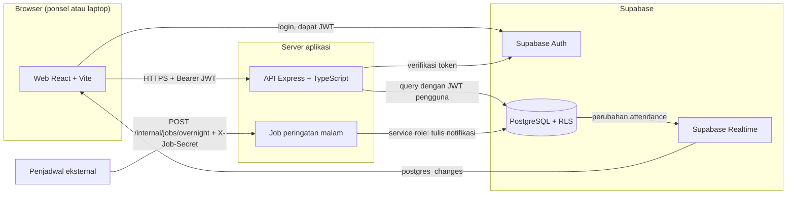
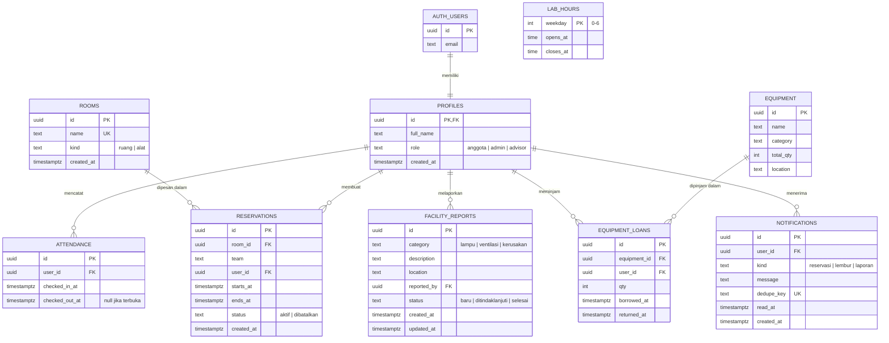
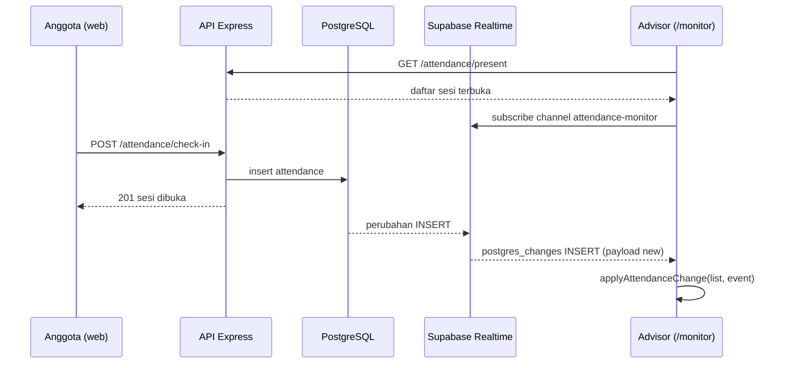
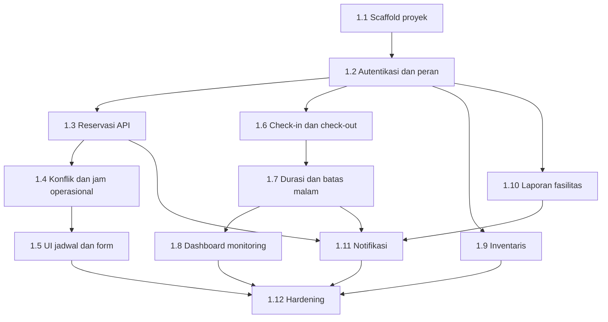

# PRD LabManage

## 1. Ringkasan

LabManage adalah sistem untuk mengatur fasilitas, penjadwalan, dan pemantauan lab Tim Robotik PENS/UKM. Sistem ini mencatat reservasi ruang dan alat, mencatat kehadiran anggota saat berada di lab, menampilkan inventaris dan ketersediaannya, serta menerima laporan kondisi fasilitas dari anggota. Admin UKM mengelola jadwal dan status perbaikan. Advisor dapat memantau kehadiran secara real-time. Produk berbentuk web responsif yang dibuka dari ponsel maupun komputer.

## 2. Latar belakang masalah

Anggota Tim Robotik bekerja di lab sampai larut malam, sering tanpa jadwal yang jelas. Hasil survei internal menunjukkan 4 dari 5 anggota (80%) merasa kelelahan dan kesulitan mengatur waktu. Sebanyak 2 dari 5 anggota (40%) melaporkan bahwa lingkungan lab tidak mendukung kerja mereka. Reservasi ruang dan alat masih dilakukan lewat pesan grup, sehingga jadwal sering bentrok. Laporan lampu mati, ventilasi bermasalah, atau alat rusak tersebar di berbagai kanal dan jarang ditindaklanjuti dengan cepat.

## 3. Tujuan

1. Menyediakan satu sumber jadwal untuk ruang dan alat lab.
2. Mencatat kehadiran anggota secara akurat sebagai dasar pemantauan jam kerja.
3. Membantu anggota menjaga jam kerja yang sehat, dengan jam operasional lab dan peringatan saat sesi masih terbuka pada malam hari.
4. Menyediakan kanal laporan fasilitas yang terpusat dengan alur status yang jelas.

## 4. Success metrics

| No | Metrik | Target |
| --- | --- | --- |
| M1 | Pengurangan lembur malam tidak terstruktur | minimal 35% dalam semester pertama |
| M2 | Pengurangan konflik reservasi ruang dan alat | hingga 90% |
| M3 | Visibilitas durasi kehadiran anggota | advisor dan admin dapat melihat durasi kehadiran secara real-time |
| M4 | Kecepatan respons perbaikan fasilitas | respons perbaikan menjadi lebih cepat lewat kanal laporan terpusat |

## 5. Non-goals

- Tidak ada aplikasi native untuk Android atau iOS. Produk hanya berupa web responsif.
- Tidak ada integrasi dengan sistem akademik kampus.
- Tidak ada fitur pembayaran.

## 6. Persona dan user stories

### 6.1 Persona

| Persona | Peran di sistem | Tanggung jawab | Kebutuhan utama |
| --- | --- | --- | --- |
| Anggota Tim Robotik | `anggota` | Memesan ruang dan alat untuk kegiatan tim, check-in dan check-out saat berada di lab, melapor kerusakan fasilitas | Melihat slot kosong dari ponsel, memesan tanpa bentrok, tahu kapan sudah terlalu lama di lab |
| Admin UKM | `admin` | Mengelola katalog alat, membatalkan reservasi yang bermasalah, mengubah status laporan fasilitas | Daftar reservasi dan pinjaman yang akurat, alur status laporan yang jelas |
| Advisor (dosen pembimbing) | `advisor` | Memantau kehadiran dan durasi kerja anggota | Melihat siapa yang sedang di lab dan sudah berapa lama, tanpa perlu mengubah data |

### 6.2 User stories

Modul A: reservasi ruang dan alat

- US-A1. Sebagai anggota, saya ingin melihat jadwal reservasi per hari, agar saya tahu slot yang kosong sebelum mengajukan reservasi.
  - AC-A1: daftar reservasi per hari menampilkan ruang, tim, waktu mulai, dan waktu selesai.
  - AC-A2: filter ruang hanya menampilkan reservasi untuk ruang yang dipilih.
- US-A2. Sebagai anggota, saya ingin mengajukan reservasi ruang atau alat, agar tim dapat memakai fasilitas tanpa bentrok.
  - AC-A3: pengajuan yang bertabrakan dengan reservasi aktif di ruang yang sama ditolak dengan pesan konflik.
  - AC-A4: pengajuan di luar jam operasional lab ditolak dengan pesan jam operasional.
  - AC-A5: reservasi yang berhasil disimpan tercatat atas nama pengaju.
- US-A3. Sebagai anggota, saya ingin membatalkan reservasi milik saya, agar slot tersebut kembali tersedia untuk tim lain.
  - AC-A6: pembatalan oleh pemilik mengubah status reservasi menjadi dibatalkan, dan slotnya kembali kosong.
  - AC-A7: anggota tidak dapat membatalkan reservasi milik anggota lain.
- US-A4. Sebagai admin, saya ingin membatalkan reservasi siapa pun, agar jadwal yang bermasalah dapat diperbaiki.
  - AC-A8: admin dapat membatalkan reservasi anggota mana pun, dan tindakan itu tercatat pada reservasi.

Modul B: kehadiran dan durasi

- US-B1. Sebagai anggota, saya ingin melakukan check-in saat tiba di lab, agar kehadiran saya tercatat.
  - AC-B1: check-in membuka sesi dengan waktu mulai saat tombol ditekan.
  - AC-B2: check-in saat masih ada sesi terbuka ditolak dengan pesan yang jelas.
- US-B2. Sebagai anggota, saya ingin melakukan check-out saat meninggalkan lab, agar durasi kerja saya tercatat dengan akurat.
  - AC-B3: check-out menutup sesi terbuka dan menyimpan durasi kerja.
  - AC-B4: check-out tanpa sesi terbuka ditolak dengan pesan yang jelas.
- US-B3. Sebagai advisor, saya ingin melihat anggota yang sedang berada di lab beserta durasinya secara real-time, agar saya dapat memantau jam kerja mereka.
  - AC-B5: daftar anggota aktif diperbarui tanpa perlu memuat ulang halaman.
  - AC-B6: sesi yang masih terbuka setelah 21:00 WIB ditandai.
- US-B4. Sebagai anggota, saya ingin mendapat peringatan saat sesi saya masih terbuka setelah 21:00 WIB, agar saya ingat untuk pulang.
  - AC-B7: peringatan muncul di daftar notifikasi untuk setiap sesi terbuka yang melewati 21:00 WIB, tanpa duplikat pada hari yang sama.

Modul C: inventaris dan laporan fasilitas

- US-C1. Sebagai anggota, saya ingin melihat katalog alat beserta jumlah yang tersedia, agar saya tahu alat mana yang bisa dipinjam.
  - AC-C1: setiap alat menampilkan total jumlah dan jumlah yang tersedia.
  - AC-C2: jumlah tersedia sama dengan total dikurangi pinjaman yang belum dikembalikan.
- US-C2. Sebagai anggota, saya ingin meminjam alat dan menandai pengembaliannya, agar stok selalu akurat.
  - AC-C3: pinjaman yang melebihi stok tersedia ditolak.
  - AC-C4: anggota hanya dapat menandai pengembalian untuk pinjaman miliknya.
- US-C3. Sebagai admin, saya ingin mengelola katalog alat, agar data inventaris sesuai kondisi lab.
  - AC-C5: hanya admin yang dapat menambah atau mengubah data alat.
- US-C4. Sebagai anggota, saya ingin melaporkan lampu mati, ventilasi bermasalah, atau kerusakan, agar pengurus segera menindaklanjuti.
  - AC-C6: laporan wajib memuat kategori, lokasi, dan deskripsi minimal 5 karakter.
  - AC-C7: anggota dapat melihat status semua laporan yang ia buat.
- US-C5. Sebagai admin, saya ingin mengubah status laporan fasilitas, agar pelapor tahu perkembangannya.
  - AC-C8: status hanya dapat berpindah berurutan: baru, ditindaklanjuti, selesai.
  - AC-C9: setiap perubahan status membuat satu notifikasi untuk pelapor.
- US-C6. Sebagai advisor, saya ingin melihat seluruh laporan fasilitas, agar saya dapat memantau respons pengurus.
  - AC-C10: advisor dapat melihat semua laporan beserta statusnya, tanpa dapat mengubahnya.

## 7. Requirement fungsional

Jam operasional lab adalah 07:00 sampai 21:00 WIB setiap hari. Batas malam untuk pemantauan kehadiran adalah 21:00 WIB. Kedua angka ini adalah asumsi awal (lihat bagian 9) dan berlaku sebagai konfigurasi, bukan konstanta yang tersebar di kode.

### 7.1 Modul A: reservasi ruang dan alat

- FR-A.1. Sistem menampilkan reservasi per hari dan dapat difilter per ruang. Memenuhi US-A1.
- FR-A.2. Sistem menerima pengajuan reservasi berisi ruang, nama tim, waktu mulai, dan waktu selesai. Waktu selesai harus setelah waktu mulai; jika tidak, pengajuan ditolak dengan kode `VALIDATION_ERROR`.
- FR-A.3. Sistem menolak pengajuan yang rentang waktunya bertabrakan dengan reservasi aktif di ruang atau alat yang sama. Rentang yang hanya bersentuhan di batas (selesai tepat saat mulai berikutnya) tidak dianggap tabrakan.
- FR-A.4. Sistem menolak reservasi yang tidak seluruhnya berada dalam jam operasional lab.
- FR-A.5. Pemilik reservasi dapat membatalkannya. Admin dapat membatalkan reservasi siapa pun. Pembatalan mengubah status menjadi dibatalkan dan tidak menghapus data.
- FR-A.6. Reservasi berstatus dibatalkan tidak memblokir slot waktu.
- FR-A.7. Sistem mencatat pengaju (`user_id`) pada setiap reservasi, diisi dari sesi login, bukan dari input klien.

### 7.2 Modul B: kehadiran dan durasi

- FR-B.1. Anggota dapat check-in. Check-in membuka satu sesi dengan waktu mulai saat itu. Check-in saat masih ada sesi terbuka ditolak.
- FR-B.2. Anggota dapat check-out. Check-out menutup sesi terbuka. Check-out tanpa sesi terbuka ditolak.
- FR-B.3. Sistem menampilkan daftar anggota yang sedang memiliki sesi terbuka, beserta nama, waktu mulai, dan durasi berjalan.
- FR-B.4. Durasi sesi adalah waktu selesai dikurangi waktu mulai untuk sesi tertutup, dan waktu sekarang dikurangi waktu mulai untuk sesi terbuka.
- FR-B.5. Sesi terbuka yang masih berjalan setelah 21:00 WIB ditandai pada daftar kehadiran dan memicu notifikasi kepada pemilik sesi (US-B4).
- FR-B.6. Admin dan advisor dapat melihat seluruh sesi. Anggota hanya dapat melihat dan mengubah sesi miliknya.

### 7.3 Modul C: inventaris dan laporan fasilitas

- FR-C.1. Sistem menampilkan katalog alat dengan jumlah total dan jumlah tersedia.
- FR-C.2. Jumlah tersedia dihitung dari total dikurangi jumlah pinjaman yang belum dikembalikan.
- FR-C.3. Anggota dapat meminjam alat dengan jumlah tertentu. Pinjaman yang melebihi jumlah tersedia ditolak, termasuk pada permintaan yang bersamaan.
- FR-C.4. Peminjam dapat menandai pengembalian pinjamannya. Anggota lain tidak dapat menandai pengembalian pinjaman tersebut.
- FR-C.5. Admin dapat menambah dan mengubah katalog alat.
- FR-C.6. Anggota dapat membuat laporan dengan kategori `lampu`, `ventilasi`, atau `kerusakan`, lokasi, dan deskripsi 5 sampai 1000 karakter.
- FR-C.7. Status laporan berpindah hanya dalam urutan `baru`, `ditindaklanjuti`, `selesai`. Transisi lain ditolak dengan kode `INVALID_TRANSITION`.
- FR-C.8. Setiap perubahan status laporan membuat tepat satu notifikasi untuk pelapor.
- FR-C.9. Advisor dapat melihat seluruh laporan dan statusnya tanpa dapat mengubahnya.

## 8. Requirement non-fungsional

Kerangka karakteristik mengikuti ISO/IEC 25010.

| Karakteristik | Requirement | Cara verifikasi |
| --- | --- | --- |
| Keamanan (security) | Setiap tabel memakai Row Level Security. Kunci `service_role` hanya dibaca di server dan tidak pernah dikirim ke browser. Semua endpoint API memerlukan token yang valid, kecuali endpoint kesehatan. | Test RLS dengan klien anon dan JWT per peran; audit `git grep` pada tahap hardening |
| Keamanan (integritas data) | Konflik reservasi dan batas stok dijaga oleh database, tidak hanya oleh aplikasi. | Test konkurensi pada tahap terkait |
| Performa (performance efficiency) | Respons API untuk daftar jadwal dan daftar kehadiran di bawah 500 ms pada data demo, diukur secara lokal. | Pengukuran manual dengan `curl` pada data seed |
| Usability | Alur reservasi selesai dalam satu halaman form. Pesan error berbahasa Indonesia dan menyebut penyebabnya. | Uji manual alur pada tahap 1.5 |
| Responsivitas | Tampilan utama diuji pada lebar 375px, 768px, dan 1280px. Pada setiap lebar tidak ada scroll horizontal. Layout default satu kolom, grid mingguan hanya pada 768px ke atas. | Cek `document.documentElement.scrollWidth <= window.innerWidth` di ketiga lebar |
| Reliabilitas | Sesi kehadiran tidak hilang saat halaman dimuat ulang. Sistem tetap mencatat check-out walaupun klien terputus setelah request terkirim. | Test API dan pengujian manual |
| Maintainability | Aturan transisi status dan perhitungan durasi berada dalam fungsi murni yang dapat diuji tanpa database. | Unit test pada tahap terkait |
| Compatibility | Web berjalan di browser modern (Chrome, Edge, Firefox, Safari versi terbaru). | Uji manual pada Chrome dan Edge |

## 9. Asumsi, risiko, dan dependensi

### 9.1 Asumsi

- Jam operasional 07:00 sampai 21:00 WIB berlaku setiap hari. Jika pengurus memberi angka lain, konstanta dan data `lab_hours` diubah tanpa mengubah desain.
- Jumlah pengguna awal kurang dari 100 akun. Desain tidak ditujukan untuk skala besar pada fase ini.
- Setiap anggota hanya boleh memiliki satu sesi kehadiran terbuka pada satu waktu.
- Akun peran `admin` dan `advisor` dibuat dan ditetapkan oleh pengurus, bukan lewat pendaftaran publik.

### 9.2 Risiko

| Risiko | Dampak | Mitigasi |
| --- | --- | --- |
| Anggota lupa check-out | Sesi terbuka menggantung dan durasi menjadi tidak akurat | Tanda sesi melewati 21:00 WIB (FR-B.5) dan notifikasi (US-B4) |
| Pengguna mengira aplikasi native tersedia | Permintaan fitur di luar lingkup | Non-goal dicatat di bagian 5 |
| Ketergantungan pada layanan Supabase | Layanan tidak tersedia berarti aplikasi tidak bisa dipakai | Dokumentasi setup lokal dengan Supabase CLI untuk pengembangan dan uji |
| Realtime tidak andal di jaringan kampus | Dashboard advisor tidak diperbarui | Muat ulang data awal dari API; pembaruan realtime hanya tambahan |

### 9.3 Dependensi

- Supabase (PostgreSQL, Auth, Realtime) sebagai layanan utama.
- Docker Desktop untuk menjalankan Supabase lokal saat pengembangan dan pengujian.
- Node.js 22 LTS untuk API dan web.
- GitHub Actions untuk CI sejak tahap 1.1.

## 10. Arsitektur dan desain teknis

### 10.1 Keputusan tech stack

Keputusan berikut sudah final untuk Fase 1.

| Lapisan | Keputusan |
| --- | --- |
| Backend | Node.js 22 LTS, Express 5, TypeScript |
| Database, Auth, Realtime | Supabase (PostgreSQL, Supabase Auth, Supabase Realtime) |
| Otorisasi data | Row Level Security per peran: `anggota`, `admin`, `advisor` |
| Frontend | React, Vite, TypeScript; web responsif mobile-first |
| Aplikasi native | Tidak ada |
| Test | Vitest, Supertest untuk API, Testing Library dan jsdom untuk UI |

### 10.2 Arsitektur tingkat tinggi

Browser memanggil API dengan JWT dari Supabase Auth. API memverifikasi token, lalu membaca dan menulis ke PostgreSQL dengan klien yang membawa JWT pengguna, sehingga RLS tetap berlaku. Kunci `service_role` hanya dipakai API untuk tugas server (job peringatan malam dan pembuatan notifikasi). Dashboard monitoring berlangganan perubahan tabel `attendance` langsung lewat Supabase Realtime.

### 10.3 ERD skema awal

Constraint utama:

- `reservations`: `check (ends_at > starts_at)` dan `exclude using gist (room_id with =, tstzrange(starts_at, ends_at) with &&) where (status = 'aktif')` dengan extension `btree_gist`. Rentang `tstzrange` default `[)`, sehingga reservasi berdampingan tidak bertabrakan.
- `attendance`: unique partial index `(user_id) where checked_out_at is null`, sehingga hanya ada satu sesi terbuka per pengguna.
- `equipment_availability`: view `total_qty - sum(qty) where returned_at is null`. Peminjaman mengunci baris `equipment` dengan `select ... for update` di dalam transaksi.
- `facility_reports`: trigger yang hanya mengizinkan transisi `baru` ke `ditindaklanjuti` dan `ditindaklanjuti` ke `selesai`.
- `notifications.dedupe_key`: unique, berisi `overnight:<userId>:<YYYY-MM-DD>` untuk peringatan malam.

### 10.4 Kebijakan RLS per peran

Semua tabel di schema `public` mengaktifkan RLS. Peran diambil dari `profiles.role` milik `auth.uid()`. "Milik sendiri" berarti kolom pemilik (`id`, `user_id`, atau `reported_by`) sama dengan `auth.uid()`. Tanda "tidak" berarti tidak ada policy, sehingga operasi ditolak.

| Tabel | Operasi | anggota | admin | advisor |
| --- | --- | --- | --- | --- |
| profiles | select | milik sendiri | semua | milik sendiri |
| profiles | update | `full_name` milik sendiri, `role` tidak berubah | `full_name` milik sendiri | `full_name` milik sendiri |
| profiles | insert, delete | tidak (dibuat trigger) | tidak | tidak |
| rooms | select | semua | semua | semua |
| rooms | insert, update, delete | tidak | ya | tidak |
| reservations | select | semua | semua | semua |
| reservations | insert | `user_id = auth.uid()` | `user_id = auth.uid()` | tidak |
| reservations | update | `status` menjadi `dibatalkan` pada milik sendiri | semua | tidak |
| reservations | delete | tidak | semua | tidak |
| lab_hours | select | semua | semua | semua |
| lab_hours | update | tidak | ya | tidak |
| attendance | select | milik sendiri | semua | semua |
| attendance | insert | milik sendiri | milik sendiri | tidak |
| attendance | update | `checked_out_at` milik sendiri | `checked_out_at` milik sendiri | tidak |
| equipment | select | semua | semua | semua |
| equipment | insert, update, delete | tidak | ya | tidak |
| equipment_loans | select | milik sendiri | semua | semua |
| equipment_loans | insert | milik sendiri | milik sendiri | tidak |
| equipment_loans | update | `returned_at` milik sendiri | semua | tidak |
| facility_reports | select | milik sendiri | semua | semua |
| facility_reports | insert | `reported_by = auth.uid()` | `reported_by = auth.uid()` | tidak |
| facility_reports | update | tidak | `status` | tidak |
| notifications | select | milik sendiri | milik sendiri | milik sendiri |
| notifications | update | `read_at` milik sendiri | `read_at` milik sendiri | `read_at` milik sendiri |
| notifications | insert | tidak (dibuat server dengan service role) | tidak | tidak |

### 10.5 Daftar endpoint API

Semua endpoint kecuali `GET /health` dan `POST /internal/jobs/overnight` memerlukan header `Authorization: Bearer <jwt>`. Format error: `{"error":{"code":"...","message":"..."}}`.

| Method | Path | Peran | Keterangan |
| --- | --- | --- | --- |
| GET | `/health` | publik | Cek kesehatan, mengembalikan `{"status":"ok"}` |
| GET | `/rooms` | anggota, admin, advisor | Daftar ruang dan alat yang dapat dipesan |
| GET | `/reservations?from=&to=` | anggota, admin, advisor | Daftar reservasi dalam rentang waktu |
| POST | `/reservations` | anggota, admin | Buat reservasi; `409 CONFLICT`, `422 OUTSIDE_HOURS` |
| PATCH | `/reservations/:id/cancel` | pemilik, admin | Batalkan reservasi |
| POST | `/attendance/check-in` | anggota, admin | Buka sesi; `409 ALREADY_IN` |
| POST | `/attendance/check-out` | anggota, admin | Tutup sesi; `404 NOT_IN` |
| GET | `/attendance/present` | admin, advisor | Sesi terbuka dengan nama, durasi, dan `overNightLimit` |
| GET | `/equipment` | anggota, admin, advisor | Katalog dengan jumlah `available` |
| POST | `/equipment` | admin | Tambah alat |
| POST | `/equipment/:id/loans` | anggota, admin | Pinjam alat; `409 INSUFFICIENT_STOCK` |
| PATCH | `/equipment/loans/:loanId/return` | peminjam, admin | Tandai pengembalian |
| POST | `/facility-reports` | anggota, admin | Buat laporan |
| GET | `/facility-reports` | anggota (milik sendiri), admin, advisor (semua) | Daftar laporan |
| PATCH | `/facility-reports/:id/status` | admin | Ubah status; `422 INVALID_TRANSITION` |
| GET | `/notifications` | anggota, admin, advisor | Notifikasi milik sendiri |
| PATCH | `/notifications/:id/read` | pemilik | Tandai sudah dibaca |
| POST | `/internal/jobs/overnight` | job (header `X-Job-Secret`) | Buat peringatan malam; `401` jika secret salah |

### 10.6 Strategi Realtime untuk Modul B

Keputusan ini wajib diikuti pada Tahap 1.6 dan 1.8.

| Aspek | Keputusan |
| --- | --- |
| Mekanisme | Supabase Realtime `postgres_changes` |
| Tabel yang dipublikasikan | Hanya `public.attendance`, lewat `alter publication supabase_realtime add table public.attendance` |
| Nama channel | `attendance-monitor` |
| Event | `INSERT` (check-in) dan `UPDATE` (check-out) |
| Pelanggan | Halaman `/monitor` untuk peran admin dan advisor |
| Otorisasi | RLS `select` pada `attendance` berlaku untuk Realtime. Admin dan advisor menerima semua baris; anggota hanya baris miliknya |
| Payload | Baris `new` dari tabel: `id`, `user_id`, `checked_in_at`, `checked_out_at` |
| Nama anggota | Tidak ada di payload. Klien memakai daftar nama dari `GET /attendance/present`, dan memuat ulang daftar itu jika `user_id` belum dikenal |
| Penerapan di klien | Fungsi murni `applyAttendanceChange(list, event)`: `INSERT` menambah sesi, `UPDATE` dengan `checked_out_at` terisi menghapus sesi |
| Saat koneksi putus | Saat status channel kembali `SUBSCRIBED`, klien memuat ulang `GET /attendance/present` |

## 11. Roadmap implementasi

### 11.1 Urutan tahap Fase 1

Setiap tahap dikerjakan dalam satu branch `stage-<nomor>-<deskripsi>` dan satu pull request, lalu di-squash merge ke `main` setelah build dan semua test lulus.

Panah menunjukkan dependensi teknis. Eksekusi tetap berurutan dari 1.1 sampai 1.12.

### 11.2 Definisi selesai untuk setiap tahap

Sebuah tahap selesai jika semua butir berikut terpenuhi:

1. Perubahan hanya mencakup lingkup tahap tersebut.
2. Di `api/` dan `web/` (yang tersentuh): `npm ci`, `npm run lint`, `npm test`, dan `npm run build` keluar dengan kode 0.
3. Tahap yang mengubah skema menyertakan file migrasi di `supabase/migrations/` dan test RLS yang membuktikan peran tidak berhak ditolak.
4. Smoke test perilaku yang tercantum pada tahap dijalankan dan hasilnya ditempel di body PR.
5. CI di GitHub Actions hijau (sejak 1.1).
6. PR di-squash merge ke `main`, dan branch tahap dihapus.

### 11.3 Batasan global

- Node.js `>=22 <23` di `api/package.json` dan `web/package.json`; `node-version: 22` di CI.
- npm, dua proyek terpisah `api/` dan `web/`, tanpa npm workspaces.
- Vitest di kedua proyek; Supertest untuk HTTP; Testing Library dan jsdom untuk UI.
- ESLint flat config dengan `typescript-eslint`; Prettier dengan script `format:check`.
- Env API: `SUPABASE_URL`, `SUPABASE_ANON_KEY`, `SUPABASE_SERVICE_ROLE_KEY`, `PORT` (default 4000), `JOB_SECRET`, `DEMO_PASSWORD`. Env web: `VITE_SUPABASE_URL`, `VITE_SUPABASE_ANON_KEY`.
- `SUPABASE_SERVICE_ROLE_KEY` hanya dibaca di `api/src/config.ts`. `config.ts` menolak start jika `NODE_ENV=test` dan `SUPABASE_URL` bukan `127.0.0.1` atau `localhost`.
- Format error API: `{"error":{"code":"...","message":"..."}}`.
- Zona waktu aturan bisnis: `Asia/Jakarta`. Jam operasional 07:00 sampai 21:00; batas malam 21.

### 11.4 Fokus review

Kondisi yang paling mungkin merusak pengalaman pengguna, beserta tahap yang memuat test-nya:

- Reservasi berdampingan (selesai 10:00, berikutnya mulai 10:00) harus diterima. Test di tahap 1.4.
- Input waktu dengan offset zona selain `+07:00` (misalnya `Z`) harus dinilai terhadap jam operasional WIB, bukan zona server. Test di tahap 1.4.
- Dua permintaan bersamaan untuk sisa stok 1 hanya boleh meloloskan satu. Test di tahap 1.9.
- Check-in ganda dari dua tab sekaligus tidak boleh membuka dua sesi; unique index menjadi penjaga terakhir. Test di tahap 1.6.
- Job peringatan malam yang dijalankan berulang tidak boleh membuat notifikasi ganda. Test di tahap 1.11.

### 11.5 Tugas per tahap

#### Tahap 1.1: scaffold proyek

- File: `api/package.json`, `api/tsconfig.json`, `api/eslint.config.js`, `api/src/app.ts`, `api/src/server.ts`, `api/src/config.ts`, `api/tests/health.test.ts`, `web/` (template Vite `react-ts`), `web/src/App.tsx`, `web/src/App.test.tsx`, `web/src/lib/supabase.ts`, `supabase/config.toml`, `supabase/seed.sql`, `.github/workflows/ci.yml`, `.env.example`, `api/.env.example`, `web/.env.example`, `README.md`.
- Antarmuka: `createApp(): express.Express`; `loadConfig(env = process.env): Config`.
- Test: `GET /health` mengembalikan 200 dan `{"status":"ok"}`; `loadConfig` melempar error saat `NODE_ENV=test` dan `SUPABASE_URL` bukan host lokal; render `App` memuat teks "LabManage".

#### Tahap 1.2: autentikasi dan peran

- File: `supabase/migrations/<ts>_profiles.sql`, `api/src/auth/requireAuth.ts`, `api/src/supabase.ts`, `api/scripts/create-demo-users.ts`, `api/tests/auth.test.ts`, `api/tests/rls/profiles.test.ts`.
- Antarmuka: `requireAuth: RequestHandler` mengisi `req.user: { id: string; role: Role }`; `requireRole(...roles: Role[]): RequestHandler`; `userClient(jwt: string): SupabaseClient`; `serviceClient(): SupabaseClient`.
- Test: tanpa header 401; anggota ke route admin 403; admin 200; anggota A tidak dapat membaca profil anggota B; anggota tidak dapat mengubah `role` miliknya.

#### Tahap 1.3: reservasi API

- File: `supabase/migrations/<ts>_reservations.sql`, `api/src/errors.ts` (kelas `ApiError`), `api/src/reservations/routes.ts`, `api/src/reservations/service.ts`, `api/tests/reservations.test.ts`.
- Antarmuka: `new ApiError(status: number, code: string, message: string)`; route `GET /rooms`, `GET /reservations`, `POST /reservations`, `PATCH /reservations/:id/cancel`.
- Test: pemilik membuat lalu membatalkan reservasi; anggota B membatalkan milik A ditolak 403; `endsAt <= startsAt` 400.

#### Tahap 1.4: konflik dan jam operasional

- File: `supabase/migrations/<ts>_reservation_rules.sql` (`btree_gist`, exclusion constraint, tabel `lab_hours`), `api/src/reservations/hours.ts`, `api/tests/reservations-rules.test.ts`, `api/tests/hours.test.ts`.
- Antarmuka: `isWithinLabHours(startsAt: Date, endsAt: Date, hours: LabHours[]): boolean`.
- Test: overlap kedua 409 `CONFLICT`; berdampingan sukses; selesai 21:30 WIB 422 `OUTSIDE_HOURS`; reservasi dibatalkan tidak memblokir; input `Z` dinilai dalam WIB.

#### Tahap 1.5: UI jadwal dan form reservasi

- File: `web/src/lib/api.ts`, `web/src/pages/Schedule.tsx`, `web/src/pages/NewReservation.tsx`, `web/src/pages/NewReservation.test.tsx`, routing di `web/src/App.tsx`.
- Antarmuka: `apiFetch<T>(path: string, init?: RequestInit): Promise<T>` melempar `ApiRequestError { status, code, message }`.
- Test: selesai <= mulai menampilkan pesan error tanpa request; respons 409 menampilkan pesan konflik; tombol submit nonaktif selama request.

#### Tahap 1.6: check-in dan check-out

- File: `supabase/migrations/<ts>_attendance.sql` (termasuk publikasi Realtime), `api/src/attendance/routes.ts`, `api/tests/attendance.test.ts`.
- Test: check-in ganda 409 `ALREADY_IN`; check-out tanpa sesi 404 `NOT_IN`; anggota A tidak dapat membaca atau mengubah sesi anggota B; dua check-in bersamaan hanya membuka satu sesi.

#### Tahap 1.7: durasi dan batas malam

- File: `api/src/attendance/duration.ts`, `api/src/attendance/policy.ts`, `api/tests/duration.test.ts`.
- Antarmuka: `durationMinutes(session: { checkedInAt: Date; checkedOutAt: Date | null }, now: Date): number`; `isOverNightLimit(session, now: Date): boolean`; konstanta `NIGHT_LIMIT_HOUR = 21`, `TZ = 'Asia/Jakarta'`.
- Test: durasi 0 dan 90 menit; sesi terbuka memakai `now`; `overNightLimit` true pada 21:01 WIB dan false pada 20:59 WIB.

#### Tahap 1.8: dashboard monitoring

- File: `web/src/pages/Monitor.tsx`, `web/src/monitor/applyAttendanceChange.ts`, `web/src/monitor/applyAttendanceChange.test.ts`, route guard di `web/src/App.tsx`.
- Antarmuka: `applyAttendanceChange(list: PresentSession[], event: AttendanceChange): PresentSession[]`.
- Test: `INSERT` menambah; `UPDATE` dengan `checked_out_at` menghapus; event untuk sesi yang sudah ada tidak menduplikasi.

#### Tahap 1.9: inventaris

- File: `supabase/migrations/<ts>_equipment.sql` (tabel, view `equipment_availability`, fungsi `borrow_equipment`), `api/src/equipment/routes.ts`, `api/tests/equipment.test.ts`.
- Antarmuka: fungsi SQL `borrow_equipment(p_equipment_id uuid, p_qty int) returns equipment_loans` yang mengunci baris dengan `for update`.
- Test: pinjam melebihi stok 409 `INSUFFICIENT_STOCK`; dua pinjaman paralel untuk sisa 1 hanya satu sukses; anggota POST `/equipment` 403.

#### Tahap 1.10: laporan fasilitas

- File: `supabase/migrations/<ts>_facility_reports.sql` (tabel dan trigger transisi), `api/src/reports/transitions.ts`, `api/src/reports/routes.ts`, `api/tests/transitions.test.ts`, `api/tests/reports.test.ts`.
- Antarmuka: `canTransition(from: ReportStatus, to: ReportStatus): boolean`.
- Test: `baru` ke `selesai` 422 `INVALID_TRANSITION`; anggota mengubah status 403; deskripsi 4 karakter 400.

#### Tahap 1.11: notifikasi

- File: `supabase/migrations/<ts>_notifications.sql`, `api/src/notifications/create.ts`, `api/src/notifications/routes.ts`, `api/src/jobs/overnight.ts`, `api/tests/notifications.test.ts`.
- Antarmuka: `createNotification(input: { userId: string; kind: NotificationKind; message: string; dedupeKey?: string }): Promise<void>`; `runOvernightJob(now: Date): Promise<number>`.
- Test: perubahan status laporan membuat tepat satu notifikasi; job tanpa secret 401; job dengan secret membuat notifikasi untuk sesi terbuka setelah 21:00 WIB; job dua kali tidak menggandakan.

#### Tahap 1.12: hardening

- File: `api/src/validation.ts`, `api/src/errors.ts` (handler global), `supabase/seed.sql`, `docs/USAGE.md`, `api/tests/validation.test.ts`.
- Antarmuka: `validate(schema: ZodSchema, source: 'body' | 'query'): RequestHandler`.
- Test: body tidak valid 400 `VALIDATION_ERROR` dengan daftar field; error tak terduga 500 `INTERNAL` tanpa stack trace.
- Audit: `git grep -nE "(service_role|eyJhbGci|sk_live|password\s*=)" -- ':!*.md'` kosong; `git grep -n "SERVICE_ROLE" -- web` kosong; responsivitas 375px, 768px, 1280px tanpa scroll horizontal.
